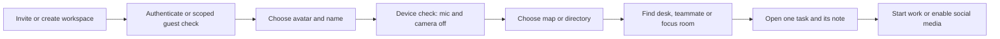

# Product requirements and user journeys

Version 1.0 · Proposed specification · 16 November 2026

## 1. Product thesis

LifeOS Spatial Office combines the social usefulness of a shared place with a personal workspace that remembers unfinished work. A person can find a teammate, protect a focus session, or return to their desk and resume a task with its notes. The map must reduce coordination effort; every core action also has a non-map path.

Primary audiences: students/study groups and small remote teams (10–50 people). The full vision includes 200-person campuses and hosted events, with explicit media and performance limits rather than 200 simultaneous video feeds per device. An enterprise buyer additionally needs ownership, provisioning, auditability and retention controls.

### Outcomes and success measures

| Outcome | Proposed pilot measure |
|---|---|
| Start useful work quickly | At least 80% of moderated first-time users reach a desk or teammate without assistance; median under 3 minutes |
| Make conversations easy to discover | Median under 15 seconds from selecting an available teammate to reaching an eligible conversation, excluding travel chosen for exploration |
| Make returning worthwhile | Track weekly use of Resume at my desk and completion of the task→session→reflection journey; establish a baseline before setting retention targets |
| Build trust | No unauthorized media delivery in security tests; no lost acknowledged chat/map writes in recovery tests |
| Respect focus | Waves and notifications honor DND; measure accidental interruptions separately from engagement |
| Stay usable | Initial desktop target: 60 FPS in a 50-person scene and at least 30 FPS in the 200-avatar stress scene on the defined baseline laptop |

Instrumentation uses event names and timings, not private note content, raw audio, screen titles or keystrokes. Do not use time-at-desk or movement as an employee performance score.

## 2. Scope and release order

| Phase | Deliverable and exit gate |
|---|---|
| P1 — A dependable place | Persistent identity/workspaces/maps, original pixel renderer, accessible HUD/directory, avatar basics, desk/task/note resume and invitations. Exit: restart/reconnect restore tests and real-device usability review. |
| P2 — Trusted live collaboration | SFU proximity A/V, quiet/private zones, locks/knocks, volume, waves/follow, persistent channels/DMs, whiteboard, simultaneous screen sharing and timed coworking. Exit: adversarial media authorization and multi-browser/network tests. |
| P3 — A complete world builder | Resizable rooms, floor/wall painting, floors/portals, 400+ licensed/original catalog entries, seasons, 10/50/200-person templates, stage/broadcast and lightweight games. Exit: map validation, asset accessibility and 200-person capacity test. |
| P4 — Intelligent async office | Consented captions/recording/summaries, reviewed action items, activity feed, two-way calendar, Slack/GitHub/webhooks. Exit: consent, deletion, sync conflict and provider outage tests. |
| P5 — Enterprise and native delivery | SAML/OIDC federation, enterprise controls, signed desktop clients/global PTT and audio-first iOS. Exit: security review, app signing/store review and platform permission/background tests. |

All phases require baseline authentication, authorization, backups and tenant isolation. P5 adds federation and enterprise policy, not the first access-control layer. The next coding phase should be P1; the full brief is a multi-release platform.

## 3. Roles and permissions

| Action | Owner | Admin | Builder | Member | Guest |
|---|---|---|---|---|---|
| Workspace ownership/billing/delete | Yes | No | No | No | No |
| Membership, guest access, retention | Yes | Yes | No | No | No |
| Draft/publish maps | Yes | Yes | Yes | Own desk decor only | No |
| Enter rooms | Within room policy | Within room policy | Within room policy | Within room policy | Explicit invite scope |
| Lock/admit in a meeting | Designated host/moderator | Designated host/moderator | If meeting host | If meeting host | Only if explicitly delegated |
| Read private DMs/recordings | Explicit participant/resource ACL only | Same | Same | Same | Invite/resource ACL |
| Broadcast | Granted stage role | Granted stage role | Separately granted | Separately granted | Off by default |

Administrative map access never grants silent meeting attendance. Emergency moderation may end a meeting or evict a participant and must be audited, not covertly subscribe to media. Guest invitations are revocable, expiring and constrained by workspace/floor/room and allowed capabilities. Password protection is an optional additional gate, not a replacement for identity and invite authorization.

## 4. Functional requirements

### Visual world and movement

| ID | Requirement | Acceptance |
|---|---|---|
| V1 | Original cozy 16/32-bit-inspired pixel art, orthographic grid with 3/4 furniture/avatar drawing; wood, plants, windows, desks, lounges, cafeteria, courtyard | Every template follows the art bible, collision footprint and layering rules; no copied Gather assets |
| V2 | Light/dark UI and optional autumn, snow and holiday overlays | Overlays never change collision/zone permissions, hide essential labels or force seasonal decoration on users |
| V3 | Hair, skin, outfit, accessory/costume customization; directional walk/idle/sit/dance/reactions/confetti | Choices persist; body layers align in every pose; reduced motion disables nonessential loops and confetti |
| V4 | WASD/arrows and click-to-path; stairs/elevators between floors | Server rejects impossible motion; inaccessible destinations explain why; typing never moves the avatar; a reconnect cannot teleport through locks |

### Audio/video and privacy

| ID | Requirement | Acceptance |
|---|---|---|
| M1 | Circular proximity with smooth receive volume/video appearance | Auto-connect only after a user explicitly enables social media for the visit; camera/mic begin off; distance thresholds have hysteresis |
| M2 | Tile-based private/quiet acoustic zones | Outsiders cannot receive track packets even with a modified client; quiet zones stop publishing; members of the same private zone hear independently of distance |
| M3 | Locked doors and knocking | Server denies unauthorized entry and paths; a knock does not grant media; admission is scoped/expiring; users can always exit |
| M4 | Spotlight broadcast tiles, floor or workspace scope | Only authorized speakers can activate; explicit preflight lists audience; broadcasts cannot pierce private zones or DND by default |
| M5 | Listener volume, optional stereo pan, echo cancellation/noise suppression | Volume/mute overrides spatial gain; mono mode is available; browser support is detected; no claim of studio-quality suppression without measurement |

Private boundary crossings immediately revoke old media permission. A fade is allowed only while both endpoints remain authorized. Separate visual-room and acoustic-zone outlines prevent misleading privacy cues. Broadcast overrides proximity, never membership/guest scope/block lists/private-room consent.

### Collaboration and objects

| ID | Requirement | Acceptance |
|---|---|---|
| C1 | Multiple simultaneous screen shares in a resizable stage | Initial supported group: 8 people, up to 4 active screen tracks; show additional eligible shares as selectable thumbnails; preserve original aspect ratio; explicit browser picker on every new capture |
| C2 | X/click to use whiteboards, documents and spreadsheets | Object states: available/loading/permission required/unsupported/offline. Embedded tools retain their provider permissions; the app never implies iframe access grants document access |
| C3 | Jukebox and casual games | Synchronized playback controls use each user's authorized provider session; no rebroadcast of protected music. Phase order: drawing game and chess, then falling-block puzzle and play-money cards; no real-money play |

X acts only on the highlighted reachable object and has an equivalent button. Multiple overlapping targets open a chooser. Whiteboard updates persist and have a reconnect/offline conflict policy. Games cannot intercept workspace keyboard shortcuts while unfocused.

### Desks, presence and alternate modes

| ID | Requirement | Acceptance |
|---|---|---|
| D1 | Assigned desk/nameplate/status/mailbox | One primary desk per member; admin reassignment preserves the person's notes; desk mail is visible only to sender/recipient unless deliberately shared |
| D2 | Available, Meeting, Focus/DND, Away with optional calendar/app hints | Manual overrides have duration; disconnected overrides all; private calendar details are never shown; active-app status is opt-in desktop-only and excludes window titles/content |
| D3 | Wave and Follow | Wave is rate-limited and DND-aware; follow requires acceptance, stops on manual movement, expiry, disconnect or restricted boundary, and never grants entry |
| D4 | Simplified directory/list view | Find, join, knock, mute, share, chat and open desk resources without navigating the map; equivalent access checks |
| D5 | Mini mode | Browser capability-gated PiP or compact app window; clear mic/camera status; desktop always-on-top mode; no unsupported browser promise |

**Presence precedence:** disconnected → manual DND → active meeting → explicit timed focus → manual availability override → calendar busy → idle Away → Available. App hints are independent decorations. Returning from idle does not clear manual DND. Calendar busy means “Busy,” not inferred attendance.

### Meeting intelligence and communication

| ID | Requirement | Acceptance |
|---|---|---|
| A1 | AI scribe creates structured summary, decisions, questions and proposed tasks when an enabled meeting ends | Scribe is opt-in for the session; statements reference transcript timestamps; uncertain owners/dates remain unassigned; no task/message publication without review |
| A2 | Live captions, searchable transcripts, cloud recording | All affected participants get a visible consent gate; late joiners consent before recorded participation; withdrawal stops collection or moves to an unrecorded meeting; retention/export/delete controls exist |
| A3 | Focused, Pomodoro and casual coworking sessions | Shared authoritative timer, own participation/leave controls, explicit host end action, optional quiet/ambient settings; browser sleep does not reset timer |
| A4 | Persistent global/room chat, scoped threaded DMs and activity feed | Acknowledged sends survive restart; retries do not duplicate; unread cursor per user; leave-note/wave/summary feed respects original ACL; deletes propagate to search and attachments |

No passive transcription of office wanderings. A conversation begins with explicit Join session or an accepted scribe/recording invitation. Automatic summarization occurs after an explicitly enabled meeting's end, not after any nearby person disappears. Suggested initial retention: chat/desk notes until deletion; recordings/transcripts 30 days; reviewed summaries until deletion; audit metadata 90 days. Admins may shorten these; final enterprise defaults require policy review. Caption-only mode must disclose whether any transcript persists; default is no retained transcript.

### Mapmaker

| ID | Requirement | Acceptance |
|---|---|---|
| B1 | Resize rooms; paint floors/walls; select/place/drag/rotate/erase objects; private/stage/quiet tile tools; connected floors/stairs/elevators | Draft edits never silently mutate a live map; publish validates spawn/exit reachability, seat ownership, zones and portal targets; Undo/Redo and previous-version rollback |
| B2 | 400+ object catalog with search/categories/color/orientation/interaction metadata | Target catalog count refers to approved usable assets, not generated placeholders; each entry has provenance, footprint, accessibility label, thumbnail, animation/performance budget |
| B3 | 10-person startup, 50-person hybrid, 200-person campus/event layouts | Capacity label distinguishes avatar capacity from media limits; all templates have arrivals, quiet work, meetings, social spaces and accessible directory equivalents |

Map edits are allowed only to builders/admins; members personalize their assigned desk inside a defined footprint. Occupied room shrink/delete requires impact preview and relocates users after media revocation. Users cannot be stranded in collision tiles or locked rooms after publication.

### Integrations, access and delivery

| ID | Requirement | Acceptance |
|---|---|---|
| I1 | Two-way Google/Outlook calendar; status and one-click room join | User selects calendars and read/write scope; conflict preview for edits on both sides; recurrence/timezone/DST/deletion tests; revoke stops sync and clears credentials |
| I2 | Slack room slash command/status, GitHub indicators, custom webhooks | Signed/idempotent ingress, allowlisted egress, retries/dead-letter inspection, minimum OAuth scopes, visible stale/offline states |
| I3 | OIDC/SAML, RBAC, protected spaces and guest links | Tenant/room authorization on every endpoint and SFU subscription; revoke access terminates sessions, not only new logins; audit and break-glass admin recovery |
| I4 | Web, signed Windows/macOS wrappers, audio-first iOS | Publish a tested capability matrix; desktop global PTT is opt-in/configurable; iOS background audio requires platform-compliant implementation and real-device tests |

## 5. Core journeys

### First visit and first useful action

Expired invite → explain and request a fresh invitation. Denied camera → remain fully usable via text/audio-only. First device prompt follows a deliberate button, not automatic page load. Returning users bypass avatar setup and receive Resume at my desk, not a forced tour.

### Daily desk and continuity

Choose task → restore desk/floor/note reference and safe avatar position → optional 25-minute focus → write a short stopping point → mark task progress → save session checkpoint. Next visit shows “You stopped at…” with a link to the exact note. Personal note content is not copied into shared objects or companion AI without explicit sharing. If a map/object was removed, open the task/note in the normal LifeOS workspace and explain the missing location.

### Spontaneous conversation and private meeting

See availability → wave or approach → user-enabled media connects inside the authorized radius → participants optionally move into a private room → confirm room audience → host locks door → outsiders knock → admit/decline → start screens/whiteboard → optionally consent to scribe → leave or end meeting. Declining a wave produces no pressure loop. Locking keeps current admitted occupants; it does not disconnect them. A private room is visibly private before any media connects.

### Build and publish

Select template → draft room/floor structure → place furniture → paint zones → connect portals → preview as member/guest → run validation → inspect affected occupants/resources → publish immutable revision → clients acknowledge → relocate affected occupants safely → retain rollback. Rejected validation identifies exact tiles/objects and does not lose the draft. Concurrent publication returns a conflict instead of silently overwriting.

### Meeting to asynchronous action

Consented conversation ends → recording/transcript finalization → summary draft with source links → host/participants review → assign tasks explicitly → publish to permitted room/channel → recipients see activity notification → click to original transcript segment or task. AI failure leaves the transcript/manual-note path usable. A user without transcript permission cannot recover its content from summary search or feed snippets.

### Guest, mobile and recovery journeys

Guest uses expiring room link → lobby/device check → authorized destination only → exits without access to unrelated directory/chat/history. Mobile user sees room list first, joins audio, can read chat/captions and leave; moving map and editing are optional/unsupported by capability. On reconnect, recover authenticated identity, snapshot and acknowledged messages; media stays visibly reconnecting and requires a fresh policy decision before forwarding resumes.

## 6. Quality gates and operating requirements

- Accessibility target: WCAG 2.2 AA for DOM controls, keyboard parity, screen-reader directory, captions, independent UI/text scaling, reduced motion/transparency, color-independent states. Validate with users; canvas alone is not accessible.
- Network test matrix: 50/150/300 ms RTT, 1/3/5% loss, changing networks, restrictive NAT/TURN, browser suspension, permission revocation and hardware unplug.
- Proposed latency targets: movement input feedback under 50 ms locally; same-region authoritative corrections p95 under 200 ms; authorized media appearance p95 under 1 second after policy grant; chat acknowledgment p95 under 500 ms under normal load. Define hardware/network fixtures in test reports.
- No “perfect” or enterprise-ready claim without real visual, touch, assistive-technology, live A/V, scale and recovery testing. Current prototype test passes do not establish these targets.
- Launch support needs operational monitoring, abuse reporting/blocking, incident playbooks, accessible onboarding, backup restoration drills and a staffed escalation route.

## 7. Prioritization decisions and unresolved costs

Keep the original pets. Make the task/note/desk continuity journey the LifeOS differentiator. Defer large catalog production until the art bible and renderer are approved. Do not market 200 users until its load tests pass. Hosting region, monthly media/recording budget, supported mobile OS versions, asset production capacity and identity provider remain implementation decisions requiring explicit selection before their respective releases; they do not block P1 design or local prototyping.
