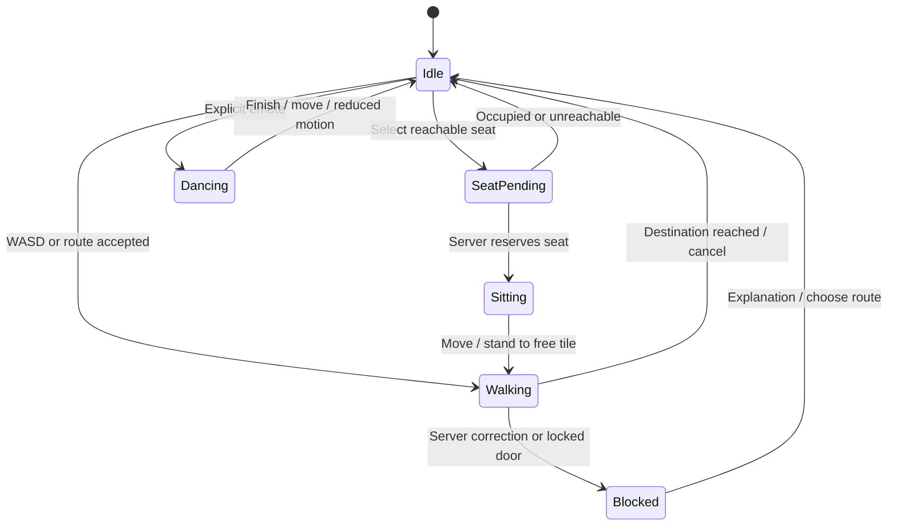
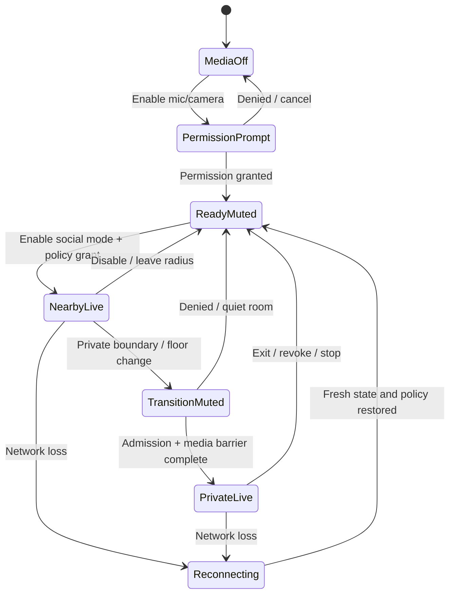

# UI/UX wireframes and visual component specification

Version 1.0 · Proposed specification · Read with the PRD and architecture

## 1. Experience principles

The map fills the available window inside a dedicated Space mode. LifeOS navigation collapses to a small workspace switcher; leaving Space does not silently disconnect an ongoing session. People and work remain the focus: the UI exposes who can hear you, your current location, and one clear next action. Glass panels have opaque fallbacks and readable contrast. Critical controls never disappear on hover.

The user-provided [Gather virtual-office reference](https://www.gather.town/virtual-office) informs discoverability, focus controls and customization. The user's requested retro pixel-art aesthetic is the art direction for LifeOS; no Gather screenshots, sprites or branding become product assets.

## 2. Art bible

| Element | Specification |
|---|---|
| Grid/perspective | 32×32 logical floor tiles; orthographic movement coordinates, furniture and characters illustrated from a 3/4 overhead angle; no isometric coordinate system |
| Rendering | Nearest-neighbor sampling; integer art scale at standard zoom stops; rounded camera coordinates; text/UI remain sharp DOM content at independent scale |
| Palette | Warm oak/tan floors, muted sage foliage, dusty blue fabrics, amber lamps; 24–40 shared core colors plus carefully bounded material ramps |
| Materials | Two/three-tone wood grain, 1-pixel edge accents, short contact shadows, soft illustrated window light; avoid mixing glossy emoji furniture and pixel sprites |
| Layers | Floor → rug/decal → low objects → Y-sorted feet/objects → foreground foliage/wall tops → labels/reactions; foreground fades when it would obscure the local avatar |
| Avatar | Approximately 32×48 pixels, feet anchored to collision point; composited skin/hair/outfit/accessory layers, four movement directions; cosmetic appearance does not change collision |
| Animation | Walk 6 frames/direction; idle 2–4 subtle frames; sit 2 entry/exit frames plus held pose; dance 6–8 frames; reactions 2–3 seconds; confetti short, rate-limited and optional |
| Seasons | Autumn decals/foliage, snow on exterior edges, holiday props; decorative layer only; snow never reduces path visibility; opt-out per viewer |
| Indoor/outdoor | Wood offices, carpeted focus rooms, tiled café, paved/grass courtyard; visible architectural transitions and signs at portals |
| Companion | Restore/preserve existing pet artwork and controls. Companion layer is independent of office-avatar artwork; 3D is not implied by shading or CSS transforms |

Asset acceptance: consistent anchors, pixel density and shadow direction; all rotations; collision/seat metadata; valid license/provenance; visible on light/dark floors; reduced-motion variant. Review one representative office, café and garden before producing the full 400+ catalog.

### Proposed UI tokens

Light: background `#F6F4EF`, surface `#FFFFFF`, text `#202C29`, muted `#56645F`, accent `#356C59`. Dark: background `#151D21`, surface `#202C31`, text `#EDF4EF`, muted `#ADBCB5`, accent `#9ACDB5`. These are starting values; all rendered combinations must pass contrast checks. Panels use 90–96% surface opacity, 12–16 px radius and restrained shadow. Spacing scale: 4/8/12/16/24/32 px. Minimum targets: 44×44 CSS px for primary touch controls, 36×36 for dense desktop tools with accessible alternatives. Fonts: a readable system sans for UI and optional licensed pixel font for nonessential map signs only.

## 3. Desktop world wireframe (1440×900 reference)

```text
┌─────────────────────────────────────────────────────────────────────────┐
│ [LifeOS ▾] [Studio floor ▾] [Search people / rooms ⌘K]    [Inbox 3] [Me]  │
│                                                                         │
│ [Map/List]                                               ┌─────────────┐ │
│ [People]     WINDOWS / PLANTS / DESK CLUSTERS              │ Nearby (3)  │ │
│ [Chat]       Ada [Focus]     You →                        │ [cam] [cam] │ │
│ [Tasks]                                                 │ [share 1]   │ │
│              room door                                  └─────────────┘ │
│ [Build]*     [Locked · 2 inside · Knock]                                 │
│                                                                         │
│         SOFAS / COWORKING RUG       WHITEBOARD  [X: Open]                 │
│                                                                         │
│ ┌──────────────┐       ┌──────────────────────────────────────────────┐ │
│ │ Mini-map     │       │ Mic off ▾ | Camera off ▾ | Share | React | … │ │
│ │ You · Floor1 │       │ Audience: nobody · Enable nearby conversation│ │
│ └──────────────┘       └──────────────────────────────────────────────┘ │
└─────────────────────────────────────────────────────────────────────────┘
 * Build appears only with edit permission
```

Top bar height 56 px; left rail width 56 px; media strip maximum 320 px wide when collapsed; bottom media dock 64–88 px high. Map extends beneath panels, but pathfinding clicks do not pass through them. Entering a shared conversation expands media only as much as needed. All panels can be closed without leaving the conversation.

## 4. Components and behavior

| Component | Contents and interaction | States |
|---|---|---|
| Workspace/floor switcher | Organization, named floor, occupancy, stairs/elevator destinations, home desk | Loading, accessible, restricted, unavailable |
| Presence nameplate | Name, icon+text status, optional app hint, wave action | Available, meeting, DND, away, reconnecting |
| Media dock | Mic/camera toggles, devices, share, captions, reactions, leave | Off, requesting, on, denied, device lost, reconnecting |
| Audience chip | “Nobody”, “Nearby: 3”, “Private: Design room · 4”, “Broadcast to Floor 2” | Updates only from authoritative policy; warning on pending transition |
| Nearby media tray | Individual tiles, active speaker, per-user volume, mute locally, pin | Joining placeholder, receiving, camera off, poor connection, leaving |
| Object affordance | Highlight/outline, name, X/click prompt, ownership/privacy indicator | Available, in use, loading, permission needed, unavailable |
| Door plate | Room name, capacity, locked status, host; knock or enter | Open, full, locked, knock pending, admitted, declined, expired |
| Desk card | Owner, status, resume task, linked note, mailbox, customize own desk | Mine, other member, unassigned, resource removed |
| Activity inbox | Mentions, waves, desk mail, reviewed summaries, integration updates | Unread, read, failed delivery, content no longer available |
| Session timer | Shared time remaining and own participation; pause/end by policy | Scheduled, running, break, finished, reconnecting |
| Companion | Current original pet, explicit context, actionable receipt + Undo | Idle, thinking, awaiting clarification, proposed action, saved/error |

Mic and camera are independent. “Connected” is not synonymous with “unmuted.” A quiet room displays a persistent explanation and disabled publish control; leaving it never automatically enables hardware that the user had disabled.

## 5. Meetings and simultaneous screen shares

```text
┌─ Private room: Product studio · 6 people · Locked ───────────── [Exit] ┐
│ [Recording OFF] [Enable captions] [Invite/Admit]                       │
│ ┌───────────────────────────┬───────────────────────────┐             │
│ │ Ada's screen              │ Your screen               │ [people]    │
│ │                           │                           │ [volume]    │
│ └───────────────────────────┴───────────────────────────┘             │
│ [Screen 3 thumbnail] [Screen 4 thumbnail] [Whiteboard]                 │
│ [Live captions or transcript drawer when enabled]                    │
│ [Mic] [Camera] [Stop sharing] [Layout] [Notes] [End meeting*]          │
└─────────────────────────────────────────────────────────────────────┘
```

Default layout prioritizes one pinned share plus a participant strip; users can switch to a 2×2 comparison grid and drag the divider. Screen text is never cropped to fill. Thumbnail selection requests a higher stream layer; offscreen streams downgrade or unsubscribe. A disabled share button explains browser/device support. Sharing a screen never includes other screens automatically. Stop remains visible even when chat/map overlays are open.

Recording state is a persistent colored bar with text, timer, owner and “What is being saved?” action. Consent is separate from device permission. A late joiner waits in a pre-media gate; declining offers an unrecorded alternative. Scribe draft UI lists evidence links, uncertain fields and Review/Discard/Publish. Proposed tasks are individually selectable before creation.

## 6. Mapmaker wireframe and editing mechanics

```text
┌─ Space Studio · Draft v23 [Preview as member ▾] [Undo][Redo] [Publish] ┐
│ Floors/Rooms      │               EDITABLE MAP         │ Inspector   │
│ ▾ Floor 1        │ [Select] [Paint] [Objects] [Zones]   │ Library     │
│   Reception      │                                    │ Width/height│
│   Library        │  resize handles / snap grid         │ Theme       │
│   Team office    │  door → next room / stairs → Floor2 │ Permissions │
│ + Room + Floor   │                                    │ Noise mode  │
│                  │  green valid / red invalid preview │ Object data │
│ Catalog          │                                    │ Interaction │
│ [Search] [Tags]   │                                    │ ACL/target  │
│ [desk] [chair]   │                                    │             │
│ [plant] [board]  │                                    │             │
│──────────────────┴────────────────────────────────────┴─────────────│
│ Validation: 1 blocked exit → Locate        Draft saved 8 seconds ago │
└─────────────────────────────────────────────────────────────────────┘
```

Draft changes autosave to a versioned workspace draft, with a visible local-unsynced state if offline. Select supports click, shift multi-select and box select. Drag snaps to grid; inspector offers numeric position/size for keyboard access. Rotation uses approved orientations; non-rotatable assets explain the restriction. Floor/wall paint has line/rectangle tools, eraser and keyboard alternatives. Zone paint uses labeled overlays: quiet, private, stage, spawn, collision and portal. Distinct private zones cannot ambiguously overlap; publish blocks unresolved overlaps.

Resize previews relocated seats, objects and portals rather than silently discarding them. Room deletion is undoable in draft; publishing requires impact review. Validation includes inaccessible spawn, missing exit/portal target, overlapping solids, unsupported assets, private boundaries, desk references and object ACLs. Publish runs compare-and-swap against the current revision; conflict offers reload/rebase rather than overwrite. Rollback creates a new revision from a prior map and runs the same safety checks.

Templates are previewed with seat count, avatar capacity, media assumptions and total floors. The 400+ catalog is searchable by category, color, size, interaction and accessibility label. Seasonal overlays use a separate layer switch. Members editing only their desk see a smaller editor with a hard footprint boundary and no zone/publish controls.

## 7. Interaction state machines





Dance, confetti, floor transitions and video fades are decorative. They must not postpone authorization revocation or obscure a permission failure. Follow displays “Following Ada · Stop” and visibly stops at restricted doors; accepting follow is not accepting future room invitations.

## 8. Directory, mobile and mini mode

Directory mode: searchable people grouped by floor/room, availability filters, current desk and permitted Join/Knock/Wave/Message actions. Clicking Join uses the same admission/path destination service as the map. A screen reader receives semantic list updates, not a live announcement for every movement tick.

Mobile: top workspace/room selector, participant list or simplified map, bottom 56 px media controls and expandable chat/captions. iOS starts audio-first; no assumption of screen capture, map editing or continuous background rendering. Respect safe areas, large text and landscape video. Desktop-only editing is clearly labeled rather than showing broken controls.

Mini mode: approximately 320×220 px, two to four media tiles or one pinned share, visible mute/camera/return/leave controls, draggable application window. A compatible browser may use Document PiP; otherwise use the main app's compact mode or signed desktop wrapper. Browser PiP is capability-gated because support is limited. [MDN Document PiP](https://developer.mozilla.org/en-US/docs/Web/API/Document_Picture-in-Picture_API).

## 9. Failure and accessibility review checklist

- Empty office: offer Resume desk, Invite and Explore templates; do not fabricate people/activity.
- Device denial: explain browser controls, continue with text, never repeat prompts in a loop.
- Connection loss: show reconnecting, disable optimistic room entry, keep typed drafts, mark queued sends and avoid duplicate notifications.
- Invalid publish: keep draft/tools open; focus the first error and link to affected tiles.
- Permission changed mid-meeting: hide/close restricted media and resource panels; announce the change without leaking content.
- Integration outage: show last successful sync and Retry; don't label stale presence as real-time.
- 200-person event: filter directory and speaker stage; don't crowd 200 labels or videos into the viewport.
- Every media action has a labeled keyboard button. Escape closes a panel and returns focus; it never unexpectedly leaves a meeting.
- No auto camera, autoplay surprise audio, flashing confetti, tiny-only controls or color-only lock indicators.
- Test 1440×900, 1024×768, 390×844 and large-text layouts in actual browsers. Verify original pet appearance and ensure the floating pet cannot block mute/leave controls.

These are implementable wireframes and component contracts, not screenshots of a completed new UI. Art fidelity and visual polish remain subject to rendered review and user feedback.
