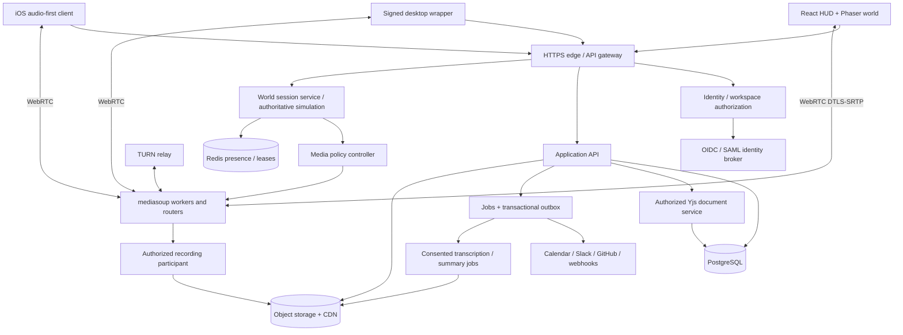
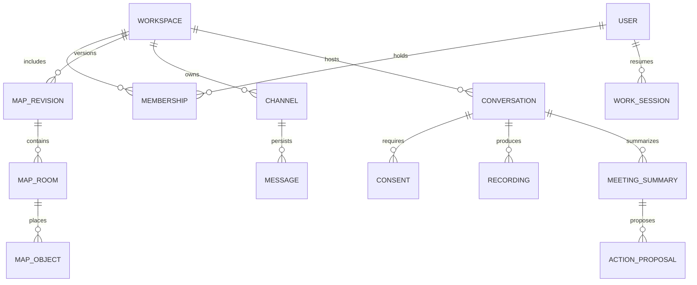

# Technical architecture blueprint

Version 1.0 · Proposed architecture · 16 November 2026

## 1. Decision summary

Retain React/TypeScript for LifeOS and accessible HUD controls. Introduce a Phaser-based pixel-world renderer behind a renderer adapter; select and pin the supported release after a compatibility spike. Use a server-authoritative world simulation, PostgreSQL for durable product data, Redis for ephemeral presence/leases, object storage for immutable map/assets/recordings, and a background-job queue. Replace the prototype's peer-to-peer media mesh with a mediasoup SFU service plus TURN. Use Yjs for shared document/whiteboard updates, not for movement or access-control truth.

These are proposed choices, not dependencies already installed. Phaser provides tilemap layers and cameras suited to a tile world; our collision/authorization model remains independent of renderer data. [Phaser tilemap documentation](https://docs.phaser.io/phaser-editor/scene-editor/game-objects/tilemap-object).

mediasoup is selected here because the application controls server-side producer/consumer creation and can enforce per-listener policies. It requires our own signaling, orchestration, recording and operational work. Managed LiveKit is an alternative if staffing favors managed infrastructure; do not mix both routing models without a separate decision record. No vendor capacity or cost assumption is treated as a measured result.

## 2. Service topology



Start with a modular application API and separately deployed world/media workers. Do not begin with dozens of microservices. Media traffic bypasses ordinary REST gateways; TURN is a relay for clients whose network cannot reach the SFU directly. Use TLS/WSS, HTTPS, authenticated TURN credentials and region-aware allocation.

## 3. Rendering, geometry and synchronization

### Renderer contract

Phaser owns tile layers, sprite atlases, animation, camera culling, particles and object hit-testing. React owns panels, dialogs, video elements, captions and accessibility. A typed event adapter passes selection/movement intent to the world client and snapshots to Phaser. Never update React state for every rendered animation frame.

Use 32-pixel logical tiles, fixed collision footprints, feet-anchored sprites, depth sorting and prepacked texture atlases. Load nearby chunks; unload distant decorative chunks, never the active collision/zone data. Seasonal overlays are cosmetic manifests. A low-power mode reduces particles, labels, sprite animation frequency and remote-video quality. Keep the accessible directory usable if WebGL fails; add a Canvas renderer only after compatibility/performance validation.

### Authoritative simulation

- One elected writer per workspace/floor shard with a fenced lease/epoch; split floors before attempting within-floor sharding.
- Initial target: 20 Hz simulation, 10 Hz delta snapshots, client render at display refresh. Validate with load tests and adjust.
- Clients send bounded movement input with monotonically increasing sequence and map revision; the server validates speed, collision, portals, seats, locks and membership. Never trust a client-supplied acoustic zone, role or position teleport.
- Client predicts its own movement and reconciles against acknowledgments; remote actors interpolate roughly 100 ms behind. Limit extrapolation to 250 ms, then freeze/show reconnecting.
- Click routes use A* on the shared navigation grid. The server validates every resulting segment; dynamic locked doors invalidate routes. Server path service handles directory Join and accessibility navigation.
- Membership in private/quiet zones derives from the avatar's feet tile at the committed simulation tick. Use explicit portal transitions; an unauthorized actor cannot enter by diagonal corner clipping.
- Seat acquisition is an atomic reservation on `(workspace, map_revision, seat_id)`; disconnect/exit/TTL releases it. Stand chooses an adjacent free tile, not an arbitrary blocked coordinate.
- Persistent world state uses immutable published map revisions; presence/movement is ephemeral. Save a throttled resume checkpoint, not every frame, and validate its destination on return.

### Message envelope

```json
{
  "type": "move.input",
  "protocolVersion": 1,
  "sessionId": "opaque-session-id",
  "requestId": "idempotency-id",
  "seq": 184,
  "worldEpoch": 12,
  "mapRevision": 23,
  "payload": {"dx": 1, "dy": 0}
}
```

Server responses carry `serverTick`, `lastAckSeq`, `worldEpoch`, `mapRevision` and `policyEpoch`. Reject stale/invalid epochs; return a fresh snapshot. Durable mutations also return resource ID/version. Separate movement deltas from reliable control messages and durable chat writes; don't persist raw motion streams as analytics.

## 4. Acoustic policy and SFU routing

### Media boundaries

A logical workspace can contain multiple SFU routers. Assign an open floor to a router initially; place restricted private meetings in separately authorized router domains where feasible. On scale-out, pipe only authorized producers between routers through a policy-aware service. Server-side consumers remain the authorization boundary even inside one router.

Permission is directed: sender A may be broadcast to listener B without B being sent to A. A proximity chain A↔B↔C does **not** give A access to C. Connected-component grouping must never widen pairwise permissions.

```text
eligible(sender, listener, track, committedState):
  deny if session expired, workspace differs, guest scope disallows,
          participant blocked, track unpublished, or policy epoch stale
  deny if sender or listener is in a media-transition barrier
  deny quiet-zone publication; honor listener's chosen receive/DND mode
  if either endpoint is inside a private zone:
      allow only same private-zone ID + valid admissions + resource policy
      ignore distance; deny outside broadcast by default
  else if track is an authorized active stage broadcast:
      allow only its explicit floor/workspace audience, respecting all ACLs
  else:
      require same floor, opted-in social mode and authorized proximity
  screen tracks additionally require explicit sharing and conversation scope
```

No overlapping private zones at publication. Quiet, private and stage conflicts are validation errors unless a documented override exists; defaults fail closed. Closed doors do not change unrelated zones. Admin status alone never grants private-media subscriptions.

### Distance curve, panning and hysteresis

Proposed defaults: enter receive eligibility at 7 tiles, remain eligible until 9 tiles, full volume within 2 tiles. For an authorized listener, `t = clamp((distance-2)/(9-2),0,1)` and `gain = (1 - (3*t*t - 2*t*t*t)) * userVolume`; local mute forces zero. Smooth gain updates over about 150–250 ms while still authorized. At the outer boundary revoke forwarding; fade is not a privacy mechanism. Video tiles fade in visually after a real track exists, and disappear after authorization loss.

Web Audio routes each authorized audio stream through gain and optional stereo pan; pan is a clamped horizontal offset, with a mono/nonspatial mode. Feature-detect constraints for `echoCancellation`, `noiseSuppression` and `autoGainControl`. Per-user volume is private local preference. Browser autoplay restrictions require an initial user interaction; surface an “Enable audio” action instead of claiming playback has begun.

### Producer/consumer lifecycle

1. Authenticate session and authorize room/floor participation; allocate send/receive WebRTC transports.
2. User explicitly enables mic/camera or screen capture; validate track kind, source, quotas and active permissions before creating a producer.
3. Policy computes eligible directed edges from committed world state using a spatial hash to avoid an all-pairs scan.
4. Create each authorized consumer paused; signal its parameters to the listener; after readiness acknowledgment, recheck the policy epoch and resume it.
5. On movement/role/lock/guest expiry, recompute only affected edges. Revoke consumers at the SFU, then notify the UI. The client cannot restore a denied consumer with a fabricated subscribe request.
6. Adapt video layer/bitrate to viewport, pinning and measured connection quality; offscreen tracks pause or unsubscribe within policy.

mediasoup leaves application signaling to the application and recommends initially paused consumers to avoid consuming before the remote endpoint is ready. [mediasoup signaling lifecycle](https://mediasoup.org/documentation/v3/communication-between-client-and-server/).

### Private transition barrier

For entry, exit, teleport, kick or map publication: mark actor transitioning → increment policy epoch → pause/revoke old producer forwarding and consumers across all involved workers → wait for acknowledgments → commit new zone/position → issue new permitted consumers → publish new UI audience state. If acknowledgments time out, keep the actor muted/reconnecting; never optimistically deliver private media. Private-router rejoin avoids sharing an open-floor transport capability with a private room. Discard late signaling/consumer-ready events with old epochs.

Packets legitimately delivered before revocation cannot be recalled; clients flush playback buffers on a boundary transition. Privacy testing measures server cutoff from the authoritative decision, not an impossible promise to erase previously received media. Track packet counters must show zero new unauthorized forwarding after the revocation barrier completes.

### Locks, knocks and stages

Door lock state and admissions are server-owned records. Knock emits a scoped notification, no location movement or media token. Admission is single-visit/expiring and bound to user/session/zone; locking preserves current authorized occupants. Guests have no inherited knock bypass. Exiting is always allowed. Host disconnect has a configurable moderator transfer/timeout, never traps occupants.

Broadcast requires a granted role plus explicit start confirmation with audience scope. Stage entry alone does not activate a microphone. Floor audience excludes private rooms by default; private-room members may join a public broadcast only by an explicit mode transition that closes their private stream. Broadcasting across a workspace uses authorized router piping, not accidental all-workspace subscription.

## 5. Screen sharing, recording and AI

Separate producers for microphone, camera, screen-video and optional screen-audio. Initial UI supports four concurrent screens in an eight-person collaboration group; cap received camera tiles (initial target nine) and prioritize selected screen text. Never reuse a stale screen-sharing grant to start capture. Browsers require a user-triggered screen picker and do not permit persisted capture permission; platform audio capture support varies. [MDN getDisplayMedia](https://developer.mozilla.org/en-US/docs/Web/API/MediaDevices/getDisplayMedia).

SFUs forward streams rather than transcode them; simulcast/SVC/layer selection reduces subscriber load. Room size is not a promise that a worker can forward any arbitrary number of tracks. [mediasoup scalability model](https://mediasoup.org/documentation/v3/scalability/).

Recording/scribe is a separate, visible service participant with explicit conversation ACL, consent epoch and permitted producers. It subscribes only to a consented meeting, never to ambient campus audio. Capture individual source tracks with server timestamps; mux/composite in jobs; store manifests and encrypted objects. Provider/STT adapters produce timestamped speaker segments; summary jobs retrieve only that conversation's permitted transcript. Live captions can be transient; persistence is a separate setting.

Pipeline: session ended → finalize chunks/checksum → transcribe if enabled → produce draft summary with evidence spans → review → explicit task creation/publication. Use idempotent jobs keyed by meeting/consent/revision. Withdrawal immediately stops new collection; product policy defines deletion of previously captured chunks. Late join consent gates participation before recorder subscription. Deletion cascades into media, transcript indexes, summaries according to configured policy and backup-expiry schedules; do not imply immediate erasure of all backup copies.

Transport encryption is mandatory. Do not label it E2EE. An optional future strict E2EE mode requires client key management, rekeying and revocation; server-side recording/transcription cannot read that media without a separately consented trusted endpoint/key arrangement. Show the incompatibility explicitly. LiveKit's documentation similarly distinguishes E2EE content from TLS-protected signaling; key distribution is an application responsibility. [LiveKit encryption overview](https://docs.livekit.io/home/client/tracks/encryption/).

## 6. Persistence schema

PostgreSQL is the durable source of truth. Every tenant-owned row carries `workspace_id`, and composite foreign keys or equivalent checks prevent cross-tenant references. Enforce row-level policies where practical plus application authorization; background jobs use scoped principals. UUID/ULID identifiers, UTC timestamps, optimistic `version`, `created_at`, `updated_at`, and deliberate soft-delete policies are common columns.

| Table | Key fields / constraints |
|---|---|
| users | `id PK`, verified identity links, display_name, avatar_manifest, preferences; no raw provider tokens |
| workspaces | `id PK`, owner_id, region, policy_json, retention_json, active_revision_id |
| memberships | `(workspace_id,user_id) PK`, role, state; room/resource grants separate |
| identity_connections | `id`, workspace_id, issuer, protocol OIDC/SAML, broker_ref; domain ownership verification |
| invites | `id`, workspace_id, token_hash UNIQUE, expires_at, allowed_rooms, capabilities, max_uses, revoked_at |
| floors | `id`, workspace_id, name, sort_order; stable ID across revisions |
| map_revisions | `id`, workspace_id, parent_id, status draft/published/archived, author_id, schema_version, content_hash, object_key, version |
| map_rooms | `(revision_id,room_id) PK`, workspace_id, floor_id, bounds, theme, acoustic defaults |
| map_objects | `(revision_id,object_id) PK`, room_id, asset_id/version, transform, footprint, interaction_ref; indexed by room |
| zones | `(revision_id,zone_id) PK`, floor_id, type, tile_mask_ref, priority, capacity, access_policy_id |
| portals | `(revision_id,portal_id) PK`, source tile, destination floor/room/tile, access_policy_id; validated bidirectionality when requested |
| assets | `id/version PK`, owner/catalog, atlas/object keys, dimensions, footprint, labels, variants, provenance/license, approval_status |
| desks | `id`, workspace_id, stable_object_id, assignee_id; unique active primary desk per member |
| desk_notes | `id`, workspace_id, desk_id, sender_id, recipient_id, body, read_at, resource_acl |
| work_sessions | `id`, workspace_id, user_id, task_ref, note_ref, desk_ref, checkpoint_text, start/end; personal ACL by default |
| room_locks | `(workspace_id,zone_id) PK`, locked, host_id, version, updated_at |
| admissions | `id`, zone_id, user_id/session_id, issued_by, expires_at, consumed_at; scoped grants |
| channels | `id`, workspace_id, type global/room/dm, room_id nullable, policy_id |
| channel_members | `(channel_id,user_id) PK`, joined_at, read_cursor, role; explicit DM membership |
| messages | `id`, workspace_id, channel_id, sender_id, parent_id, body, client_id; UNIQUE(sender_id,client_id); index(channel_id,created_at,id) |
| activities | `id`, workspace_id, recipient_id, type, resource_ref, dedupe_key, read_at; no copied private payload by default |
| conversations | `id`, workspace_id, zone_id, host_id, state, started/ended, policy_id |
| conversation_members | `(conversation_id,user_id) PK`, joined/left, role; attendance does not override consent |
| consents | `(conversation_id,user_id,epoch,purpose) PK`, granted/withdrawn timestamps, policy_version |
| recordings | `id`, conversation_id, consent_epoch, manifest_key, state, retention_until, encryption_ref |
| transcript_segments | `id`, conversation_id, speaker_ref, start_ms/end_ms, text, confidence, revision; ACL-filtered search index |
| meeting_summaries | `id`, conversation_id, source_revision, draft/reviewed/published, content, reviewed_by |
| action_proposals | `id`, summary_id, text, owner/date nullable, evidence_spans, accepted_task_id; unique conversion ID |
| coworking_sessions | `id`, workspace_id, zone_id, host_id, mode, started_at, ends_at, state/version |
| documents / document_updates | `id`, workspace_id, object_ref, policy_id, snapshot_ref; updates `(doc_id,sequence)` with compaction checkpoints |
| integration_connections | `id`, workspace_id, user_id, provider, scopes, vault_secret_ref, cursor, state |
| external_events | connection_id, external_id, occurrence_id, etag, local_event_id, sync_hash, tombstone; unique external mapping |
| webhook_deliveries / outbox | delivery_id/idempotency_key, connection/event, status, attempts, next_retry; bounded/redacted payload |
| audit_events | append-only ID, workspace, actor, action, resource, timestamp, outcome; exclude raw media/secrets |



Redis: session presence with short TTL, floor writer leases/fencing epochs, spatial buckets, transient seat reservations, knock cooldowns and rate limits. Persist room lock/admission mutations durably before acknowledging; Redis caches them but never resurrects a revoked grant. PostgreSQL transactions plus an outbox make chat/task/activity events durable before fanout. Search indexes are derived and enforce resource ACL on query and fetch.

## 7. Maps, documents and offline behavior

Map drafts use revisioned operations, server validation and compare-and-swap publishing. Paint strokes and object operations have inverse operations for Undo; a published rollback is another revision. Publish atomically advances workspace active revision only after content objects/checksums and policy validation exist. World services use a revision barrier and safe relocation. Do not mix old collision tiles with new acoustic masks.

Yjs handles collaborative note/whiteboard updates through an authenticated document service; membership is checked before receiving updates and on revocation. Persist update streams and compact snapshots; use IndexedDB for local offline drafts, then resync only after renewed authorization. Yjs supports incremental document updates and IndexedDB-backed offline storage, but authorization remains our service's responsibility. [Yjs updates](https://docs.yjs.dev/api/document-updates), [offline persistence](https://docs.yjs.dev/getting-started/allowing-offline-editing).

Offline mode supports private notes, personal room drafts and resume checkpoints. Shared-room presence/media/locks cannot be simulated as live offline. Replayed durable writes need request IDs and conflict handling; never queue stale Admit/Broadcast/Unmute commands for automatic replay. Existing browser data stays local until the user selects an account import/sharing action; validate and back it up before migration.

## 8. API and event contracts

| Interface | Purpose / invariant |
|---|---|
| `POST /workspaces`, `/invites`, `/sessions` | Authenticated creation and scoped invite redemption; single-use/count limits atomic |
| `GET /world/snapshot` + WSS `world.delta` | Authorized snapshot and ordered epoch/version deltas |
| WSS `move.input`, `seat.claim`, `portal.enter` | Intent only; authoritative validation; explicit result/rejection |
| `POST /zones/:id/knocks`, `/admissions`, `/lock` | Rate-limited and role-checked; optimistic lock version |
| `POST /maps/:id/publish` | Expected revision + idempotency key; validation report or new revision |
| WSS `media.transport`, `produce`, `consumer.ready` | Session-bound signaling; policy recheck before creation/resume |
| `POST /channels/:id/messages` | Persist/authorize/dedupe before ACK and fanout |
| `POST /conversations/:id/consents`, `/recording` | Explicit purpose/consent epoch; service participant authorization |
| `POST /summaries/:id/actions/:action/accept` | Revalidated task permission; idempotent reviewed conversion |
| `GET /activity?cursor=...` | Recipient/resource-scoped pagination; no private snippet leaks |
| `/integrations/:provider/callback`, `/webhooks/:provider` | OAuth state/PKCE where supported; signed ingress and durable queue |

## 9. Integrations and object sandbox

Calendar connections store encrypted refresh tokens in a secret vault and persist provider cursors. Google uses incremental sync tokens; Microsoft Graph uses calendar/time-range delta links. Save the cursor only after all pages/events commit. Webhooks wake a sync job rather than constituting the sole source of truth. Invalid cursors trigger a controlled resync. Map recurring occurrences, timezones, all-day events, cancellations and tombstones explicitly. Use provider versions/ETags and a three-way comparison to detect conflicting edits; echo suppression prevents loops. [Google incremental sync](https://developers.google.com/workspace/calendar/api/guides/sync), [Microsoft calendar delta](https://learn.microsoft.com/en-us/graph/delta-query-events?view=graph-rest-1.0).

Slack slash commands resolve to signed/expiring LifeOS deep links and honor both workspace memberships. GitHub indicators use authorized repository scopes and sanitized event summaries. Validate signatures on original request bytes and reject stale/replayed requests where provider semantics permit; use delivery IDs plus semantic idempotency. Queue before acknowledging and expose failures. [Slack verification](https://api.slack.com/authentication/verifying-requests-from-slack), [GitHub verification](https://docs.github.com/en/webhooks/using-webhooks/validating-webhook-deliveries).

Custom outbound webhooks have signed payloads, retry backoff, replay controls and SSRF protection on registration and every delivery/redirect/DNS resolution. Never send private note bodies by default. Active-app presence belongs to an opt-in native adapter with an allowlist and coarse app identifier only; browsers cannot inspect arbitrary desktop applications.

Object manifests declare interaction type, resource ID, permission scope and UI label. Embedded provider content runs in sandboxed, allowlisted iframes with explicit postMessage origin checking; no arbitrary uploaded JS. Providers may forbid framing; offer Open externally. Asset uploads use format/size validation, malware scanning, safe rasterization where needed, provenance and signed CDN access. Games run in isolated modules with bounded messages/state; jukeboxes synchronize authorized playback rather than redistribute audio.

## 10. Security, operations and capacity

OIDC authorization-code flow through an identity broker; SAML federation terminates at that broker with issuer/audience/signature/replay validation. Use short-lived session/media capabilities, refresh rotation, revocation propagation and TLS. Enforce RBAC plus room/resource ACL in REST, WSS, media, search and background jobs. Password-gated spaces hash passwords with a modern password KDF and rate-limit attempts. Native apps use OS-protected credentials, signed updates and restricted IPC; never expose Node integration to remote embedded content.

Initial capacity targets: 50 concurrent avatars per office release, then a tested 200 across campus floors; typical conversation 8 participants; nine visible camera tracks, four screen shares. For a 50-person floor with eight received cameras/person, camera forwarding alone can produce about 400 consumer edges, before microphones/screens. Worker count must follow measured CPU/egress/packet loss, not a fixed users-per-server claim. Budget TURN and recording egress separately. Large-stage delivery may need multiple routers and carefully authorized piping.

Proposed same-region objectives: API availability 99.9%; acknowledged durable writes RPO 0 within the synchronous datastore failure model; regional disaster target RPO ≤5 minutes and RTO ≤60 minutes, subject to replication/restore drills. Those are proposed goals, not existing guarantees. Monitor world tick lag, reconciliation rate, unauthorized subscribe denials, SFU consumer count, RTT/loss/jitter, join success, TURN percentage, queue lag, media cost/minute and storage retention. Never log tokens, transcript text or screen contents into general telemetry.

Failure behavior: world writer fails → fenced replacement and snapshot reconnect; media policy service fails → no new grants, expire short policy leases/fail closed; SFU worker fails → reconnect visibly muted; database unavailable → preserve local drafts and reject uncommitted durable mutations; STT/AI fails → retain permitted manual/transcript workflow and retry without duplicate tasks. Backups require restoration tests and separate deletion/retention schedules.

## 11. Cross-platform delivery and test plan

Web: React+Phaser with capability checks for capture, codecs, Web Audio, PiP and WebGL. Desktop: proposed Electron wrapper for predictable WebRTC support and an opt-in global push-to-talk shortcut; test focus loss, key-up loss, stuck-key watchdog, sleep and macOS/Windows permissions. iOS: proposed SwiftUI audio-first client with a maintained WebRTC integration; validate SFU interoperability, background audio/session interruption and store requirements before committing release support. No promise that a PWA alone supplies system-wide shortcuts or native iOS capture.

Before P2 release, run two-browser and malicious-client tests for private boundary crossing, forged subscription, old epoch replay, blocked guests, floor changes, stage scope, lock/admit expiry, reconnect, publisher disappearance and map publication. Packet-level assertions must accompany UI checks. Test simultaneous screens, Safari/Chromium/Firefox behavior, TURN-only networks, denied permissions and device removal. P3 adds 50/200-person load scenarios; P4 adds consent/retention/deletion and provider-sync fault injection; P5 adds SSO and signed native-client audits.

## 12. Migration from the current codebase

1. Freeze and version existing local room/map schemas; preserve `lifeos.space.studio`, shared drafts, Journal and backup compatibility.
2. Extract a renderer-independent world model from `shared/studioWorld.ts`; introduce Phaser behind an adapter while retaining a rollback path to `StudioArt.tsx` during review.
3. Add identity, durable workspace/map/chat services. Replace first-connection host authority with persistent permissions; session moderators remain a distinct concept.
4. Keep current audio behind a development feature flag while implementing SFU transports/policy. Do not advertise private production meetings on the current mesh.
5. Introduce explicit zone/portal/desk IDs and safe map-revision transitions; expand catalog and rendering only after geometry compatibility tests.
6. Add the work-session checkpoint connecting existing Home tasks and Journal references to assigned desks. Keep private content outside shared map manifests and AI context by default.
7. Add recordings/integrations/native clients behind their own gates. Update handoff and acceptance evidence per milestone; production rollout needs selected hosting, credentials, budget and operational ownership.
